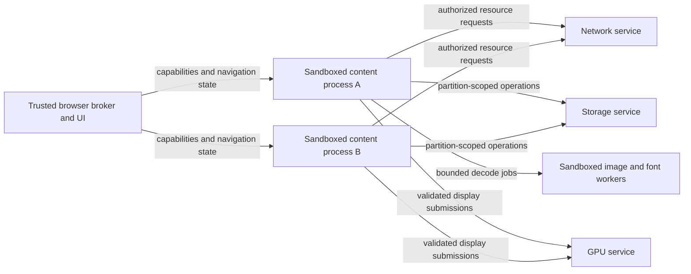

# BroWSER architecture

Status: proposed implementation architecture. Reviewed against primary references on
2026-11-16. This repository contains the development plan and its validation tools;
none of the engine components described here is implemented yet.

## Objective and system boundary

Build an independent engine for the web: first-party HTML tree construction, DOM,
CSS cascade and style resolution, layout, painting, compositing integration, and
browser host APIs. A browser shell supplies windows, tabs, trusted navigation UI,
permissions, profile management, and updates. The shell and engine must remain
separable so a headless test runner exercises the same code as the graphical app.

The first useful product is an offline document renderer with a declared HTML/CSS
subset and deterministic images. The next products are an isolated networked
document viewer, a scripted application browser, and a broader compatibility
release. A limited viewer is never described as a general-purpose secure browser.
Competitive parity with existing engines is a research and delivery objective,
not a result asserted by the presence of source code or a single benchmark.

## Decisions and review triggers

These are planning decisions, not claims about implemented mechanisms.

| ID | Decision | Status | Evidence required before implementation commitment |
| --- | --- | --- | --- |
| A01 | Rust for new first-party engine and broker code; isolate necessary native library calls behind narrow reviewed interfaces | Selected direction | Compiler/toolchain pin, supported-target builds, FFI ownership rules, dependency license inventory |
| A02 | Develop custom DOM, style, layout, and paint algorithms; use existing standards and their tests | Selected direction | Per-feature specification mapping, reference fixtures, and independent compatibility results |
| A03 | Evaluate SpiderMonkey as the JavaScript/WebAssembly VM rather than build a new VM alongside the rendering engine | Proposed, feasibility gate | Standalone build on chosen targets, Rust embedding prototype, GC rooting review, release-update rehearsal, license review, measured footprint |
| A04 | Linux x86-64 is the first supported runtime; macOS is an additional developer platform; Windows is a later port | Selected direction | Explicit Linux kernel/runtime baseline and CI image chosen during bootstrap; macOS carries no public-browsing safety claim until its sandbox gate passes |
| A05 | Reuse maintained implementations of TLS, HTTP transport, Unicode data, shaping, font rasterization, image codecs, and GPU abstraction | Selected direction | Candidate/version/security/license evaluation recorded before each dependency enters the lockfile |
| A06 | Start with deterministic CPU rendering and an explicit display list; add GPU execution after correctness baselines exist | Selected direction | CPU image/reftest corpus; GPU output equivalence, driver-loss recovery, and sandbox tests |
| A07 | Use process isolation before enabling arbitrary network content | Mandatory release constraint | The process and adversarial tests in [SECURITY_MODEL.md](SECURITY_MODEL.md) pass on every supported runtime |

SpiderMonkey is Mozilla's JavaScript and WebAssembly library and exposes native
embedding interfaces. Selecting it would reuse language execution, not Firefox's
DOM or layout engine. Its heap is garbage collected, so a Rust binding alone does
not establish safe ownership. The feasibility review must resolve native roots,
tracing callbacks, finalization, cross-language cycles, thread affinity, and VM
updates before adding browser APIs. [Mozilla SpiderMonkey documentation](https://firefox-source-docs.mozilla.org/js/index.html).

An unfavorable embedding result reopens A03 with a written comparison of other
maintained VMs. It does not justify a fake scripting API that silently succeeds.
No external dependency candidate is approved solely by appearing in this plan.

## Process model

These are target roles. The offline renderer may initially use one process with
no network or profile access. Enabling remote content requires the separated,
tested roles that its attack surface needs; a single-process development mode
cannot be promoted to a release mode.

| Role | Owns | Must not receive |
| --- | --- | --- |
| Browser broker/UI | Windows, trusted origin display, process lifecycle, navigation commits, permission decisions, file-picker grants | Raw HTML parsing, image decoding, web script execution |
| Content process | A compatible agent-cluster grouping, DOM, styles, layout, script realms, input dispatch, accessibility snapshots | Ambient filesystem, raw sockets, profile database, global clipboard, update credentials |
| Network service | Transport, TLS verification, request policy enforcement, cookies, HTTP cache, cancellation | Renderer-supplied authority to change its origin, top-level site, credentials mode, or partition |
| Storage service | Partitioned persistent stores, quotas, deletion, migrations, private-session lifetime | Arbitrary paths or renderer-selected database locations |
| Codec workers | One bounded class of untrusted image/font decoding jobs | Network, profile access, arbitrary file opens |
| GPU service | Validated rendering commands and owned surfaces | Renderer-defined native pointers, unrestricted profile or network access |

The broker chooses process assignment using browsing-context groups,
agent-cluster rules, origin isolation, and cross-origin isolation requirements.
“One process per tab” is insufficient: a tab may contain mutually untrusted frames.
Initial remote browsing can reject unsupported cross-origin embedding through a
visible product restriction while out-of-process frame support is developed.
It cannot co-locate those frames and still claim the eventual isolation guarantee.
The HTML standard's agent and realm model is the semantic source for this design.
[HTML web application APIs](https://html.spec.whatwg.org/multipage/webappapis.html).

All IPC uses versioned message schemas, length/depth bounds, explicit identities,
and revocable capability handles. The broker derives authority from its own
navigation state. Document generations invalidate late responses, permissions,
surface updates, and input acknowledgments after navigation. Shared buffers have
fixed maximum sizes, validated offsets, explicit ownership, and sealed or copied
read-only transfers where applicable. No process treats a peer's successful
deserialization as authorization.

## Document pipeline and ownership

1. **Navigation and fetch:** the broker resolves the destination and creates a
   navigation generation. The network service returns bounded byte streams and
   response metadata under that navigation's authority. Redirects and final
   origins are revalidated before commit.
2. **Decode and parse:** implement encoding selection, incremental tokenization,
   and the HTML tree-building algorithm, including malformed input recovery.
   Parser state is explicit across chunk boundaries. Encoding restarts, scripts
   that block parsing, and later DOM mutation must not create a second hidden
   document model.
3. **DOM and events:** use stable generational node handles in a document-owned
   store. Detachment is not destruction when script or ranges retain a node.
   Mutations update tree invariants and dirty state through one controlled path.
   Event dispatch records the required path and handles mutation/reentrancy.
   Node trees and event behavior follow the [DOM standard](https://dom.spec.whatwg.org/).
4. **Style:** tokenize CSS with recovery; parse selectors and declarations;
   implement cascade origin, importance, specificity, source order, inheritance,
   and computed values. Resolve custom properties, pseudo-elements, media queries,
   and layers in the feature milestones that claim them. Unsupported declarations
   follow specified CSS recovery; they do not become invented browser features.
5. **Layout:** derive the box tree from computed styles, then build fragment trees
   with explicit containing blocks and formatting contexts. Start with block and
   inline flow, whitespace, margins, borders, padding, and overflow. Add positioning,
   floats, tables, flexbox, grid, fragmentation, and writing modes as separately
   tested work. A DOM node may produce zero, one, or several formatting boxes;
   [CSS Display](https://www.w3.org/TR/css-display-3/) and the
   [CSS visual formatting model](https://www.w3.org/TR/CSS2/visuren.html) supply the
   relevant model, with newer CSS modules taking precedence where they supersede it.
6. **Paint and composition:** convert fragments into immutable display lists with
   explicit clips, transforms, stacking contexts, resources, and hit-test regions.
   Rasterize into deterministic CPU surfaces first. Later GPU execution consumes
   validated commands; the content process never constructs native driver calls.
7. **Presentation and input:** tag displayed frames and hit-test maps with the
   same document/layout generation. Route input to the correct frame; reconcile
   asynchronous scrolling and compositor transforms. The UI owns focus transfers,
   permission prompts, and trusted navigation indicators.

Each stage accepts bounded data, reports actual failures, supports cancellation,
and emits tracing events with a navigation ID. A correctness-first invalidation
path may recompute a full document. Incremental style/layout is introduced only
when it produces the same result as that path under mutation and resizing tests.
Concurrency begins with immutable work snapshots and deterministic merges;
parallel layout is not a prerequisite for a correct first renderer.

## Scripting and browser APIs

Keep VM access on its permitted execution thread. A document owns its script
realms and native wrapper registry. Wrapper identity survives repeated access;
native objects that hold VM values register traced edges or roots. Root removal,
finalizer execution, listener cycles, detached subtrees, and document shutdown
need stress-GC tests. Raw native object pointers cannot cross IPC.

Bindings are generated from an audited Web IDL subset and checked against binding
tests. Each exposed interface implements its required conversions, exceptions,
property behavior, and relevant-realm checks; adding an empty interface for an
unsupported feature is prohibited. The interface source is the
[Web IDL standard](https://webidl.spec.whatwg.org/).

The host owns task queues, microtask checkpoints, timer cancellation, promise
rejection reporting, script interruption, rendering opportunities, and navigation
teardown. Preserve observable ordering before optimizing scheduling. Modules,
workers, service workers, shared memory, and WebAssembly each receive separate
capability and lifetime reviews. They remain unavailable until implemented and
tested; the VM containing a language feature does not establish a safe web host.

## Origin, networking, and storage

Use one canonical URL representation and one origin abstraction throughout the
broker, network service, bindings, history, and storage. An origin is never a
string prefix or a hostname-only comparison. Opaque origins carry distinct
identities. URL parsing, serialization, and origin derivation follow the
[URL standard](https://url.spec.whatwg.org/).

The network service receives request intent plus broker-issued context and
enforces redirects, request modes, credentials, referrer policy, CORS, response
tainting, and cache partitions according to the [Fetch standard](https://fetch.spec.whatwg.org/).
It owns cookies so a compromised renderer cannot read `HttpOnly` values or send
arbitrary credentials. TLS certificate verification is mandatory and uses a
maintained implementation and a documented trust-store/update policy. Network
enablement additionally requires the policy gates in the security model.

Define a typed storage key before adding persistence. It includes the origin and
the applicable top-level partition context; opaque and private contexts cannot
accidentally alias a normal profile. Start with in-memory state for the offline
renderer. Add cookies, cache, local storage, IndexedDB, and service-worker storage
only with individual transaction, quota, crash-recovery, clear-data, and partition
tests. Persistence belongs to the storage/network services; page code gets no
file paths. Profile schema migrations preserve backup/rollback strategy, and a
private session is kept distinct from persistent profiles and crash telemetry.

## Text, accessibility, and platform integration

Text layout needs shaping, fallback fonts, cluster-aware selection, line breaking,
bidirectional text, vertical writing, emoji, zoom, and input methods. Keep logical
text offsets separate from visual glyph positions. Use maintained Unicode data
and shaping libraries rather than treat one code point as one glyph. Bidi work
tracks the [Unicode Bidirectional Algorithm](https://unicode.org/reports/tr9/),
with pinned data and conformance fixtures for every supported Unicode revision.

Derive a semantic accessibility tree from document semantics and computed
visibility, not from paint rectangles alone. Preserve stable accessible node IDs,
names, roles, states, relations, focus, live-region events, and text ranges across
updates. Expose bounded snapshots to a broker-side platform adapter so content
processes have no general desktop-bus authority. Test keyboard-only navigation,
zoom, IME composition, screen-reader flows, and focus after navigation. Platform
mapping work is anchored in [Core Accessibility API Mappings](https://www.w3.org/TR/core-aam-1.2/).

The initial shell provides only the UI needed to exercise these behaviors.
Extensions, mobile integration, DRM, proprietary media, password management, and
sync are separate product investments with explicit compatibility and security
reviews; their absence cannot be hidden behind inactive UI controls.

## Verification and engineering boundaries

Every implemented feature links its specification behavior, local regression
tests, and relevant pinned web-platform-tests selections. WPT is a shared
cross-browser suite; its result archive can inform comparisons, but BroWSER must
publish its own runs with revision, environment, selection, skips, crashes,
timeouts, and denominator. [WPT documentation](https://web-platform-tests.org/).

Use fuzzing for streaming parsers, selectors, layout mutations, codecs, IPC, and
binding conversions; compare optimized paths with simple internal reference
paths. Use visual reftests with pinned fonts and image resources, GC stress tests,
fault injection, leak/heap profiling, cancellation races, sandbox negative tests,
and accessibility integration checks. A milestone result includes raw evidence,
not only a summary percentage.

Do not create empty engine crates or API methods to imply progress. Add a
component when its first coherent behavior, tests, failure handling, and build
instructions are delivered together. Proposed directory boundaries may become
libraries during implementation, but this document is not a requirement to create
unused directories. BroWSER's current runnable code validates the plan itself;
it is not an engine benchmark or a standards-conformance result.
